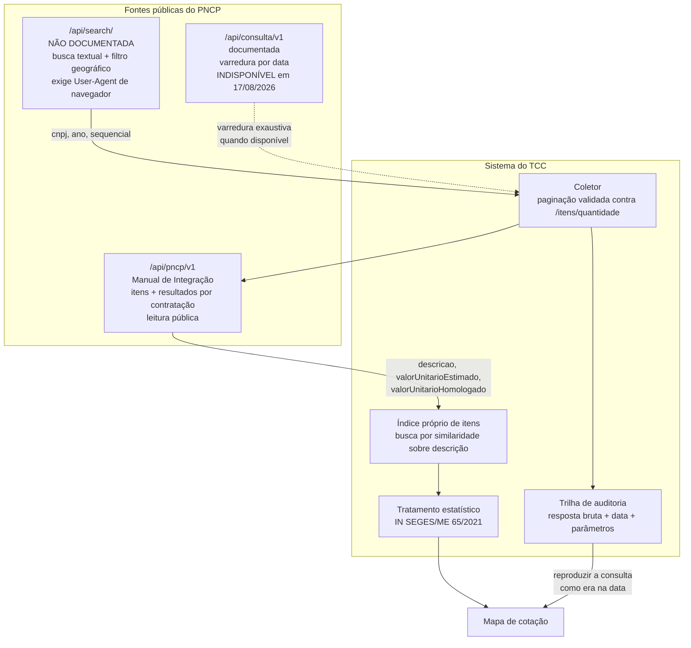

# Viabilidade técnica do módulo de pesquisa de preços via API do PNCP

## 1. Contexto

O Art. 23, §1º, I da Lei nº 14.133/2021 nomeia o Portal Nacional de Contratações
Públicas como parâmetro para fixação do valor estimado da contratação. O módulo
de pesquisa de preços proposto no projeto depende disso: se a API pública do
PNCP não entregar **preço unitário por item**, o módulo perde o alicerce legal
e metodológico, e metade do trabalho precisa ser redesenhada.

Esta era a única incógnita capaz de derrubar parte do projeto antes de qualquer
linha de código, e a mais barata de resolver. Por isso foi verificada primeiro.

## 2. Pergunta central

A API pública do PNCP permite recuperar, sem credencial de acesso, a descrição,
a quantidade, a unidade de medida e o **preço unitário** dos itens de
contratações já encerradas, com filtro geográfico e temporal, em volume
suficiente para compor uma cesta de preços?

## 3. Resposta curta

**Sim, mas não pela API que a documentação de consulta anuncia.** A resposta
exige combinar duas APIs distintas, uma delas não documentada, e conhecer três
armadilhas que fazem o resultado parecer correto quando está incompleto.

| Pergunta | Resposta | Evidência |
|---|---|---|
| Existe preço unitário por item? | **Sim** — estimado e homologado | §5.2, §5.3 |
| Precisa de credencial? | **Não**, para leitura | §5.3 |
| Existe filtro por UF e município? | **Sim** | §5.4 |
| Existe busca por descrição do item? | **Não** | §5.5 |
| A API de consulta oficial serve? | **Não** — e estava fora do ar | §5.1 |

## 4. Método

Verificação empírica em 17/08/2026, entre 09h51 e 10h20 (horário de Brasília),
sobre o ambiente de **produção** do PNCP. Foram consultadas três fontes
primárias e realizadas requisições reais:

| # | Fonte | Tipo |
|---|---|---|
| 1 | `https://pncp.gov.br/pncp-consulta/v3/api-docs` — OpenAPI da API de Consulta | primária |
| 2 | `https://pncp.gov.br/manual/pt-br/latest/singlehtml/` — Manual de Integração | primária |
| 3 | `https://pncp.gov.br/pncp-api/v3/api-docs` — OpenAPI da API de Integração | primária |

Toda afirmação abaixo marcada **[provado]** foi verificada com requisição real
cujo código de retorno e corpo foram inspecionados. As marcadas **[hipótese]**
não foram confirmadas e estão declaradas como tal.

O volume de requisições foi mantido deliberadamente baixo — cerca de 60 no
total, contra um serviço público.

## 5. Achados

### 5.1. A API de Consulta documentada não resolve o problema — e estava indisponível

A API anunciada como interface pública de consulta (`/api/consulta`, Swagger em
`pncp.gov.br/api/consulta/swagger-ui`) expõe **12 endpoints**. Nenhum deles
retorna itens de uma contratação. **[provado]**

O objeto devolvido pela consulta de contratações (`RecuperarCompraPublicacaoDTO`)
carrega apenas `valorTotalEstimado` e `valorTotalHomologado` — valores **no
nível da contratação inteira**, inúteis para cotar um item específico.
**[provado]**

O único preço unitário alcançável por essa API é o de item de Plano de
Contratação Anual (`PlanoContratacaoItemDTO.valorUnitario`), que é **valor de
planejamento, não preço praticado**. Serve para outra finalidade. **[provado]**

Além disso, **todos os endpoints dessa API responderam com erro durante toda a
janela de verificação:**

| Endpoint | Retorno | Tempo |
|---|---|---|
| `/v1/contratacoes/publicacao` | 500, depois 504, depois 502 | 51–70 s |
| `/v1/contratos` | 504 | 70 s |
| `/v1/atas` | 504 | 70 s |
| `/v1/contratacoes/proposta` | 504 | 70 s |
| `/v1/pca/` | 503 | 0,17 s |

O corpo do primeiro erro foi explícito: `"Erro na comunicação com o banco de
dados."` Os 504 vieram do gateway após 70 s exatos. Não é erro de parâmetro: a
mesma indisponibilidade ocorreu em quatro endpoints distintos, com e sem filtro
de UF, com janelas de data de um único dia. **[provado]**

Ao mesmo tempo, o portal e as outras duas APIs respondiam em menos de 0,7 s — a
falha era do serviço de consulta, não da infraestrutura do PNCP. **[provado]**

> **Consequência para o projeto.** Indisponibilidade da fonte de dados é risco
> operacional real, não hipotético — foi observado no primeiro dia de teste. O
> sistema precisa de cache local e de degradação graciosa, e o texto precisa
> registrar a data e a duração da indisponibilidade observada. Isto reforça,
> por si só, a necessidade de persistência própria — que é o recorte de banco de
> dados do trabalho.

### 5.2. Os dados existem — na API de Integração

O documento em `pncp.gov.br/manual/` é o **Manual de Integração**, que descreve
a API de envio de dados usada pelas plataformas dos órgãos. Ele não é um manual
de consulta — daí a dificuldade de encontrar nele o que o projeto precisa.

Mas entre seus serviços estão consultas que a API de Consulta não oferece:

| Serviço | Endpoint |
|---|---|
| 10.13 Consultar Itens de uma Contratação | `GET /v1/orgaos/{cnpj}/compras/{ano}/{sequencial}/itens` |
| 10.14 Consultar Item de uma Contratação | `.../itens/{numeroItem}` |
| 10.17 Consultar Resultados de Item | `.../itens/{numeroItem}/resultados` |
| — Quantidade de itens | `.../itens/quantidade` |

Base de produção: `https://pncp.gov.br/api/pncp`.

**Campos que interessam ao módulo de cotação** — todos confirmados em resposta
real: **[provado]**

De `/itens`:

| Campo | Significado |
|---|---|
| `descricao` | descrição do produto ou serviço, até 2048 caracteres |
| `quantidade` | quantidade, 4 casas decimais |
| `unidadeMedida` | unidade de fornecimento |
| `valorUnitarioEstimado` | **preço unitário estimado**, 4 casas decimais |
| `criterioJulgamentoNome` | menor preço, maior desconto, etc. |
| `temResultado` | se já houve homologação |
| `orcamentoSigiloso` | quando `true`, os valores vêm zerados |

De `/itens/{n}/resultados`:

| Campo | Significado |
|---|---|
| `valorUnitarioHomologado` | **preço unitário efetivamente contratado** |
| `quantidadeHomologada` | quantidade homologada |
| `dataResultado` | data da homologação |
| `nomeRazaoSocialFornecedor`, `niFornecedor` | fornecedor vencedor |
| `porteFornecedorNome` | ME, EPP, demais |
| `situacaoCompraItemResultadoNome` | situação do resultado |

`valorUnitarioHomologado` é exatamente o dado que a IN SEGES/ME nº 65/2021
admite como parâmetro de pesquisa de preços: preço praticado em contratação
pública. **[provado que o campo existe e vem preenchido; a adequação
normativa ainda precisa ser confrontada com o texto da IN — ver §8]**

### 5.3. A leitura é pública

O Manual de Integração, seção 5.4, afirma: *"O acesso ao Portal de consultas é
público. Já as APIs de manutenção (serviços de inserção, retificação ou
exclusão de dados) requerem autenticação/autorização."*

Isso é a base normativa. A confirmação empírica é mais forte: **[provado]**

- Requisição a `/itens` com CNPJ inválido retornou **400 com erro de validação
  de CNPJ** — e não 401 ou 403. A requisição atravessou a camada de
  autenticação e chegou à validação de negócio.
- Requisições com dados reais retornaram **200** sem nenhum cabeçalho
  `Authorization`.
- 15 requisições sequenciais a endpoints de resultado: **15 de 15 com 200**,
  média de **217 ms**, sem bloqueio nem throttling observável.

Não foi encontrado `robots.txt` no domínio (resposta vazia). Não foram
observados cabeçalhos de rate limit. **[provado]** Isso **não** significa que
não exista limite — significa que não foi atingido em volume baixo.
**[hipótese: limites podem existir e aparecer em volume maior; deve ser
tratado com backoff desde o início.]**

### 5.4. Busca com filtro geográfico existe — em API não documentada

Nem a API de Consulta nem o Manual de Integração oferecem busca textual. Ela
existe em `https://pncp.gov.br/api/search/`, que é o serviço usado pela própria
tela de consulta do portal e **não aparece em nenhum dos dois documentos
oficiais**.

Duas descobertas sobre ela: **[provado]**

1. **Exige `User-Agent` de navegador.** Sem esse cabeçalho o servidor encerra a
   conexão (`SSL_read: connection reset`, sem código HTTP). Com ele, responde
   200 em ~0,25 s.
2. **Devolve exatamente a chave que liga as duas APIs:** `orgao_cnpj`, `ano` e
   `numero_sequencial` — os três parâmetros de que `/itens` precisa. Também
   devolve `numero_controle_pncp`, `municipio_nome`, `uf`,
   `modalidade_licitacao_nome`, `data_publicacao_pncp`, `tem_resultado`,
   `valor_global` e o `total` de resultados.

Filtros verificados um a um, comparando o total retornado: **[provado]**

| Parâmetro | Funciona | Observação |
|---|---|---|
| `q` | sim | **obrigatório**; sem termo não há resposta útil |
| `ufs` | sim | sigla da UF |
| `municipios` | sim | id interno do PNCP, não código IBGE |
| `modalidades` | sim | id da modalidade |
| `esferas`, `poderes` | sim | M/E/F e E/L/J |
| `orgaos` | sim | id interno do órgão |
| `anos` | sim | **plural**; `ano` no singular é ignorado |
| `status` | sim | valor `encerradas`, **plural** |
| `tipos_documento` | sim | `edital`, `ata`, … |
| `situacao`, `situacoes` | **não** | ignorado |
| `data_publicacao_*`, `data_inicial`, `dataFinal` | **não** | ignorado |
| `tem_resultado` | **não** | ignorado como filtro |

> **Armadilha grave.** Parâmetro desconhecido é **silenciosamente ignorado** —
> sem erro, sem aviso. `status=encerrada` no singular não filtra nada e devolve
> o mesmo total que a busca sem filtro; `status=encerradas` filtra. Uma consulta
> pode parecer restrita e não estar. Para um trabalho que promete trilha de
> auditoria e reprodutibilidade, isso significa que **cada filtro precisa ser
> validado por contraprova de contagem**, não presumido.

Também **não há curinga**: `q=a` e `q=*` retornam zero. A busca serve para
procurar por termo, **não para varredura exaustiva** de um período ou município.
Varredura exaustiva depende da API de Consulta — justamente a que estava fora
do ar. **[provado]**

### 5.5. O achado que sustenta o recorte de banco de dados

**A busca do portal casa o termo contra o objeto da contratação, não contra a
descrição dos itens.** **[provado]**

A prova: uma contratação municipal de 2025 com 223 itens tem, no item 181, um
microscópio digital eletrônico. A busca por `microscópio digital eletrônico`
restrita ao Pará retornou 38 resultados — e essa contratação **não estava entre
eles**. Os resultados eram compras cujo *objeto* mencionava equipamento
hospitalar.

A consequência é direta e é o eixo acadêmico do trabalho:

> Para pesquisar preço **por item**, não basta consumir a API. É necessário
> percorrer as contratações, baixar os itens de cada uma, **construir um índice
> próprio sobre as descrições** e pesquisar nesse índice.

Isso não é detalhe de implementação — é a razão de existir do problema de dados.
E explica por que persistência vetorial e busca por similaridade não são enfeite
tecnológico no projeto: a descrição de item é texto livre de até 2048
caracteres, escrito por servidor diferente em cada município, sem catálogo
obrigatório (os campos `catalogo` e `catalogoCodigoItem` vieram nulos nos itens
inspecionados). "Papel A4 75 g/m²" e "resma de papel sulfite branco A4
gramatura 75" são o mesmo produto e não casam por igualdade de string.

### 5.6. Paginação: a armadilha que corrompe silenciosamente uma cotação

O endpoint `/itens` retorna **10 itens por padrão**, num **array JSON puro** —
sem envelope de paginação, sem campo de total, e **sem nenhum cabeçalho HTTP de
total ou de próxima página**. **[provado]**

A contratação examinada tem **223 itens**. Sem paginação explícita, a resposta
traz 10 e **parece completa**: um array JSON válido, HTTP 200, nenhum aviso.
**95,5% dos dados desaparecem sem sinal algum.**

Comportamento verificado: **[provado]**

| Chamada | Resultado |
|---|---|
| `/itens` | 10 itens (itens 1–10) |
| `/itens?pagina=2` | 10 itens (itens 11–20) |
| `/itens?tamanhoPagina=100` | 100 itens |
| `/itens?tamanhoPagina=200` | 200 itens |
| `/itens?tamanhoPagina=500` | 223 itens — todos |
| `/itens/quantidade` | `223` |

Regra de implementação derivada: **sempre consultar `/itens/quantidade` antes,
e conferir que o número de itens coletados bate com ele.** Uma cotação montada
sobre coleta parcial produz valor estimado errado com aparência de correto — e
é o tipo de erro que nenhum teste de "a requisição funcionou" pega.

### 5.7. Volume

Contagens obtidas com termo de busca genérico, restritas ao Pará: **[provado]**

| Recorte | Resultados |
|---|---|
| Editais com o termo "aquisição", Pará | 19.549 |
| Idem, filtrado a um município de pequeno porte | 39 |
| Editais com "papel", Pará | 3.274 |
| Editais com "papel", Brasil | 154.143 |

Ordem de grandeza para o índice local: um município pequeno movimenta algumas
dezenas de contratações por ano; uma contratação pode ter centenas de itens. Um
índice de itens de âmbito estadual está na casta das centenas de milhares a
milhões de registros — volume que justifica decisão de indexação, mas
perfeitamente tratável no hardware disponível.

## 6. Arquitetura que os achados impõem

Quatro exigências que deixaram de ser opinião e passaram a ser consequência do
que foi medido:

1. **Índice próprio de itens** — porque a busca oficial não alcança a descrição
   do item (§5.5).
2. **Persistência da resposta bruta com data e parâmetros** — porque a fonte
   fica indisponível (§5.1) e porque a promessa de reproduzir uma pesquisa
   exatamente como ela era exige guardar o que foi recebido, não só o que foi
   calculado.
3. **Validação de completude na coleta** — porque a paginação falha em silêncio
   (§5.6) e porque filtro inválido é ignorado sem erro (§5.4).
4. **Backoff e cache** — porque a fonte é serviço público de terceiro, sem
   contrato de disponibilidade, e já foi observada fora do ar.

## 7. Riscos identificados

| Risco | Gravidade | Evidência | Mitigação |
|---|---|---|---|
| Dependência de API não documentada (`/api/search/`) | **alta** | §5.4 | Isolar atrás de interface própria; ter a API de Consulta como caminho alternativo; documentar a dependência no texto |
| Indisponibilidade da fonte | **alta** | §5.1 — observada | Cache local; coleta assíncrona; nunca depender de chamada ao vivo na hora de gerar o documento |
| Coleta parcial silenciosa | **alta** | §5.6 | Conferência obrigatória contra `/itens/quantidade` |
| Filtro ignorado sem erro | média | §5.4 | Contraprova de contagem por consulta |
| Orçamento sigiloso zera valores | média | campo `orcamentoSigiloso` | Descartar da cesta, registrando o descarte |
| Descrição heterogênea entre municípios | média | §5.5 | É o problema de pesquisa, não um defeito a esconder |
| Mudança de contrato da API sem aviso | média | API não documentada | Teste de contrato no pipeline |

## 8. O que ficou em aberto

Declarado como não verificado, para não virar suposição depois:

1. **A adequação do `valorUnitarioHomologado` como parâmetro da IN SEGES/ME
   nº 65/2021** não foi confrontada com o texto da Instrução Normativa. O campo
   existe e traz preço praticado; se a IN admite esse parâmetro, em que ordem de
   preferência e com quais ressalvas, é leitura pendente.
2. **Rate limit real** — não atingido em 15 requisições. Desconhecido.
3. **Se a indisponibilidade da API de Consulta é transitória ou crônica.** Uma
   janela de 30 minutos num único dia não decide isso. Vale repetir a medição
   em dias diferentes antes de afirmar qualquer coisa no texto.
4. **Como recuperar a compra a que um item pertence sem passar pela busca
   textual** — a varredura exaustiva depende da API de Consulta.
5. **Estabilidade do id interno de município** usado por `/api/search/`, que não
   é o código IBGE.

## 9. Conclusão

O módulo de pesquisa de preços é **viável**. O dado essencial — preço unitário
por item, com fornecedor e data — está acessível publicamente e sem credencial.

Mas a viabilidade vem com uma correção importante de premissa: **não é um caso
de "consumir uma API pública"**. É um caso de construir persistência e índice
próprios sobre dados que a fonte oficial só entrega de forma fragmentada, por
duas interfaces distintas, uma delas não documentada, com armadilhas que
produzem resultado incompleto sem sinalizar erro.

Isso torna o trabalho mais difícil e academicamente mais defensável. O problema
de banco de dados não precisou ser justificado por conveniência de orientação:
ele apareceu por si, na primeira tarde de verificação técnica.
