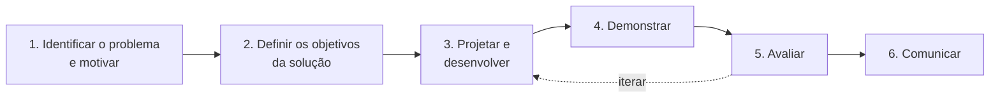

# Classificação da pesquisa e modelagem do processo

> ## Como ler esta nota
>
> A reunião de orientação de outubro pediu três coisas: classificar a pesquisa,
> com a sugestão de *Design Science Research* e a alternativa de estudo de caso;
> modelar o processo de compras em BPMN; e firmar a contribuição científica,
> porque evento de sistemas de informação recusa artigo que só apresenta sistema.
>
> A nota responde nessa ordem, mas começa pelo que mais interessa decidir: **o
> que a classificação cobra e quanto custa**.
>
> Regras de sempre: fonte só entra lida por inteiro; metadado conferido na
> fonte primária. As fontes canônicas foram escolhidas por contagem de citação
> na base de literatura acadêmica, e não por impressão — seção 10.

## 1. Resposta curta

1. **Recomendação: *Design Science Research* como classificação da pesquisa,
   com o estudo na prefeitura como contexto de avaliação dentro dela.** É o
   enquadramento que descreve o que o trabalho faz — construir e avaliar um
   artefato para um problema levantado em campo [1][2][3]. A literatura em
   português lida trata as duas coisas como compatíveis: estudo de caso pode
   servir dentro de uma pesquisa desse tipo; e [4], citando outros autores,
   critica chamar de "estudo de caso" a aplicação de um método numa única
   organização.

2. **O argumento mais forte para a orientação é que a contribuição científica
   que ela pediu já tem lugar previsto no método.** A diretriz de contribuição
   de Hevner e colegas lista três tipos, e um deles é exatamente o
   desenvolvimento de **métodos e métricas de avaliação** [1]. O protocolo que
   corrige o viés do gabarito é contribuição desse tipo — não é implementação.

3. **O custo é real e concentra-se em cinco pontos**, que o texto ainda não
   tem: critérios de aceitação fixados antes de medir; a declaração explícita
   de qual artefato é a contribuição e de que tipo ele é; a classe de problemas
   para a qual o resultado vale; o registro das alternativas de projeto
   descartadas; e a avaliação executada com rigor, não só planejada — seção 4.

4. **A literatura de avaliação acrescentou três leituras ao achado do viés do
   gabarito**, e uma delas é contraprova que precisa estar no texto: coleções
   montadas só com sistemas lexicais avaliam mal os sistemas de vetor [5]; mas
   coleções profundas e diversas resistem [6]; e, com um só relevante por
   consulta, avaliadores preferem com frequência o que o sistema novo trouxe ao
   que estava anotado [7]. O gabarito deste trabalho é raso e de um tipo só —
   o pior caso nos termos dos próprios defensores da robustez — seção 6.

5. **BPMN: modelar em formato aberto e versionável, e tratar a ferramenta
   pedida como visualizador.** A ferramenta indicada não roda no sistema
   operacional da máquina de trabalho e grava em formato próprio. Isso precisa
   ser conversado com a orientação antes — seção 8.

## 2. As fontes

### 2.1 Lidas por inteiro

| # | Fonte | Papel nesta nota | Citações na base |
|---|---|---|---|
| [1] | Hevner, March, Park e Ram, 2004, *MIS Quarterly* | As sete diretrizes; o arcabouço ambiente–pesquisa–base de conhecimento; os métodos de avaliação | 13.434 |
| [2] | Peffers, Tuunanen, Rothenberger e Chatterjee, *Journal of Management Information Systems*, 2007 | O processo em seis atividades e os quatro pontos de entrada | 7.705 |
| [3] | Hevner, 2007, *Scandinavian Journal of Information Systems* | Os três ciclos: relevância, rigor e projeto | — |
| [4] | Lacerda, Dresch, Proença e Antunes Júnior, 2013, *Gestão & Produção* | Referência em português; classe de problemas; comparação com estudo de caso e pesquisa-ação | 138 |
| [5] | Yilmaz, Craswell, Mitra e Campos, 2020, SIGIR | Coleção montada só com sistemas tradicionais avalia mal os neurais | 21 |
| [6] | Voorhees, Soboroff e Lin, 2022, preprint | A contraprova: coleção profunda e diversa resiste | 31 |
| [7] | Arabzadeh, Vtyurina, Yan e Clarke, 2022 | Rótulo esparso; julgamento por preferência | — |

"Citações na base" é a contagem que a base de literatura acadêmica devolveu em
14/10/2026, usada para escolher as canônicas. Traço quando a base não a
informou na consulta feita.

### 2.2 Canônicas que não foram lidas

| Fonte | Por que importa | Por que não entrou |
|---|---|---|
| March e Smith, 1995, *Decision Support Systems* (4.512 citações) | Origem da tipologia de artefatos — constructos, modelos, métodos, instanciações | Acesso fechado; sem cópia aberta localizada. A tipologia é usada aqui **como [1] a apresenta** |
| Gregor e Hevner, 2013, *MIS Quarterly* (3.039 citações) | O quadro de posicionamento da contribuição — melhoria, exaptação, invenção — e o esquema de artigo | Acesso fechado; sem cópia aberta localizada. **Não citar** até ler |
| Venable, Pries-Heje e Baskerville, 2016, *European Journal of Information Systems* (1.096 citações) | O arcabouço de estratégias de avaliação | O repositório que guarda a cópia aberta recusou o acesso automatizado |
| Wieringa, 2014, livro (1.159 citações) | Ciclo de projeto e ciclo empírico para sistemas de informação e engenharia de software | Livro; não obtido |
| Dresch, Lacerda e Antunes Júnior, 2015, livro | A referência corrente em português em formato de livro | Livro; não obtido |
| Buckley, Dimmick, Soboroff e Voorhees, 2007, *Information Retrieval* (152 citações) | Coleções com poços rasos favorecem documentos que contêm as palavras do tópico — viés lexical documentado | O endereço de acesso aberto devolveu página, não o artigo |

Gregor e Hevner é a ausência que mais pesa: é a fonte que diz como redigir a
contribuição. Vale insistir no acesso pela biblioteca.

## 3. O ciclo, nos termos da literatura, aplicado a este trabalho

### 3.1 Os três ciclos

Hevner organiza a pesquisa em três ciclos que devem estar presentes e
identificáveis [3]:

| Ciclo | O que é [3] | Neste trabalho |
|---|---|---|
| **Relevância** | Traz do ambiente os requisitos e os critérios de aceitação; devolve o artefato ao ambiente para teste de campo | A prefeitura de referência, a servidora que cota, o levantamento de 06/09/2026, o gabarito de 231 itens e a sessão de julgamento |
| **Rigor** | Traz da base de conhecimento teorias, métodos e o estado da arte; devolve a ela o conhecimento novo | Literatura de recuperação e de avaliação, os sistemas existentes, a lei e as instruções normativas |
| **Projeto** | Constrói e avalia o artefato, em iterações mais rápidas | A bateria de modelos de representação, o filtro estruturado e o sistema |

Dois trechos de [3] servem de critério para o texto. O ciclo de relevância
"define critérios de aceitação para a avaliação final" — antes, não depois. E o
ciclo de projeto exige equilíbrio: argumento forte para construir não compensa
avaliação fraca.

### 3.2 As seis atividades

Peffers e colegas propõem um processo nominal em seis atividades, que também
serve de estrutura para o artigo [2]:

| Atividade [2] | O que [2] pede | Neste trabalho | Estado |
|---|---|---|---|
| 1. Identificação do problema e motivação | Definir o problema e justificar o valor da solução | Levantamento de campo: o gargalo é decidir se um preço candidato é comparável, porque a busca é por palavra; os sistemas existentes confirmam | **Feito** |
| 2. Objetivos da solução | Inferir objetivos do problema, quantitativos ou qualitativos | Quantitativo: proporção dos preços escolhidos que aparecem entre os primeiros resultados, sob o filtro estruturado, contra a busca por palavra. Qualitativo: registro da decisão e de seu motivo | **Parcial:** falta escrever os valores que contam como sucesso |
| 3. Projeto e desenvolvimento | Determinar função e arquitetura; criar o artefato | Bateria de modelos, filtro estruturado, protocolo de avaliação, sistema | Em curso |
| 4. Demonstração | Usar o artefato numa instância do problema | Os itens reais da prefeitura de referência | Planejada |
| 5. Avaliação | Comparar os objetivos com o observado; decidir se itera | Bateria contra o gabarito, com teste pareado; sessão de julgamento às cegas | Planejada |
| 6. Comunicação | Comunicar problema, artefato, utilidade, novidade, rigor e eficácia | TCC e artigo | — |

**Ponto de entrada.** [2] admite quatro. Este trabalho tem entrada **centrada no
problema** — atividade 1 —, a que [2] descreve como a de pesquisa que nasce da
observação do problema. É a entrada mais fácil de defender.

### 3.3 O artefato, na tipologia

[1] adota quatro tipos de artefato: constructos, modelos, métodos e
instanciações. Este trabalho produz, em princípio, três:

| Tipo [1] | O que é aqui |
|---|---|
| Método | A recuperação por proximidade de significado sob filtro estruturado obrigatório; e o **protocolo de avaliação** que corrige o viés do gabarito |
| Modelo | O modelo do processo de compras — o diagrama da seção 8 — e o modelo de dados com trilha |
| Instanciação | O sistema |

## 4. O que a classificação cobra e ainda não temos

Esta é a seção que decide. Cada linha tem a fonte da exigência e o que falta.

| # | Exigência | Fonte | O que falta | Custo |
|---|---|---|---|---|
| 1 | **Critérios de aceitação fixados antes da avaliação** | [3]; [4], que remete a [3] e pede que os parâmetros sejam justificados | Escrever, no TCC I, o que conta como sucesso: qual diferença sobre a busca por palavra, em qual medida, com qual teste | Baixo. Uma subseção. Mas compromete: o resultado será julgado contra ela |
| 2 | **Contribuição clara e verificável, em um dos três tipos**: o artefato; fundamentos; ou métodos e métricas de avaliação | [1], diretriz 4 | Dizer, numa frase, qual é a contribuição e de que tipo. Recomendação: a de **métodos de avaliação** — o protocolo — como contribuição principal; o método de recuperação como segunda; o sistema como instanciação que demonstra viabilidade | Baixo para escrever; alto se o protocolo não for executado |
| 3 | **Distinguir pesquisa de projeto rotineiro** | [1]: o que separa os dois é "a identificação clara de uma contribuição à base de conhecimento" | É a mesma cobrança que a orientação relatou do parecer recusado. O texto precisa dizer o que se sabe depois do trabalho que não se sabia antes | Médio. Exige reescrever a introdução e a conclusão em torno disso |
| 4 | **Classe de problemas** | [4]: o conhecimento só é generalizável para uma classe de problemas, não para o caso | Definir a classe. Proposta: *triagem de comparabilidade de itens descritos em texto curto e livre, em compras públicas, quando a fonte de preços busca por palavra* | Baixo. Um parágrafo; protege contra a objeção de caso único |
| 5 | **Ambiente interno, ambiente externo e mecanismo de teste explícitos** | [4] | Descrever o que o artefato é por dentro, onde opera e como se testa | Baixo; boa parte já está na arquitetura |
| 6 | **Busca de solução documentada: alternativas geradas e testadas** | [1], diretriz 6; [4] pede protocolo que registre e justifique as escolhas | A bateria de modelos já é isso. Falta registrar as alternativas descartadas e por quê | Baixo; as notas de decisão do vault já fazem parte |
| 7 | **Avaliação rigorosa com métodos adequados ao artefato** | [1], diretriz 3 e tabela de métodos; [3] | Executar a bateria e a sessão; teste de significância; intervalo. [1] cita expressamente precisão e revocação como forma de avaliar algoritmo de busca | **Alto.** É o trabalho do TCC II |
| 8 | **Comunicação a dois públicos**: técnico e gerencial | [1], diretriz 7 | O artigo para administração pública precisa da versão gerencial: o problema, o ganho, o custo | Médio |

**Limite que o próprio método reconhece.** [1] registra que o uso de um artefato
num único projeto pode não generalizar para outros ambientes. A classe de
problemas (linha 4) é a resposta; não elimina o limite, delimita.

**O que não muda.** Nenhuma das exigências contradiz o que já está desenhado. O
problema veio do campo, o gabarito existe, a bateria testa alternativas, a
sessão de julgamento é avaliação com a usuária. A classificação **dá nome e
ordem** ao que existe e cobra por escrito o que hoje está implícito.

## 5. *Design Science Research* ou estudo de caso

A orientação ofereceu o estudo de caso como alternativa mais simples. A
comparação honesta:

| Critério | *Design Science Research* | Estudo de caso |
|---|---|---|
| Descreve o que o trabalho faz? | **Sim**: construir e avaliar artefato para problema real [1][2] | Em parte: descreve a investigação na prefeitura, não a construção |
| Objetivo que acolhe | Prescritivo, de desenvolvimento de artefato [4] | Descritivo, explicativo ou preditivo [4] |
| Risco de rótulo errado | Baixo, se as exigências da seção 4 forem cumpridas | **Alto**: [4], citando Berto e Nakano (2000), registra como uso inadequado do termo chamar de estudo de caso a aplicação ou validação de um método numa única organização |
| Lugar para a contribuição de avaliação | **Previsto** na diretriz de contribuição [1] | Não previsto: a contribuição esperada é compreensão do caso |
| Avaliação exigida | Rigorosa e contra critérios fixados antes [1][3] | Rigor de coleta e análise do caso |
| Generalização | Para a classe de problemas [4] | Analítica, para a teoria |
| Custo de escrita | Maior: seção 4 inteira | Menor |
| Reconhecimento por pareceristas de sistemas de informação | [2] escreveu o processo justamente para dar a pareceristas um modelo mental; sem ele, a pesquisa de projeto "corre o risco de ser confundida" com estudo de caso de prática | Familiar, mas não descreve trabalho de construção |

**Não é escolha excludente.** [4] admite estudo de caso **dentro** de uma
pesquisa desse tipo — para entender artefatos existentes ou como forma de
avaliação —, e a tabela de métodos de avaliação de [1] lista o estudo de caso
entre os métodos observacionais. Para este trabalho, a combinação natural é:
*Design Science Research* como classificação, e o estudo na prefeitura de
referência como o contexto de demonstração e de avaliação.

**Sobre "dar mais força em evento".** As fontes lidas não medem aceitação; não
há como afirmar isso com elas. O que se pode afirmar: a chamada da trilha
principal do simpósio de sistemas de informação de 2027 exige, no resumo
estruturado, os campos "Research Method", "Related IS Theory" e "Contributions
and Impact to IS area"; e [2] argumenta que, sem um processo reconhecido,
pesquisa de projeto é confundida com pesquisa empírica fraca ou com relato de
prática. Essa é a forma defensável do argumento.

## 6. Avaliação: o que a literatura acrescentou ao viés do gabarito

A rodada anterior estabeleceu, com Rassin e colegas, que relevantes escolhidos
por um sistema de busca favorecem sistemas parecidos com ele. Três leituras
novas situam o achado.

### 6.1 A favor: poço de um tipo só avalia mal o outro tipo [5]

Yilmaz e colegas simularam coleções montadas só com sistemas tradicionais e só
com sistemas neurais, com os dados de uma trilha de avaliação de 2019. Com a
coleção tradicional, a correlação entre a ordem verdadeira e a medida dos
sistemas neurais caiu para perto de zero numa das medidas, e a coleção tendeu a
**subestimar** os neurais. A coleção neural avaliou bem os dois tipos. A
conclusão dos autores: coleção montada só com sistemas tradicionais deve ser
usada com cautela para avaliar sistemas neurais, porque pode levar a concluir
que o neural é pior quando não é.

### 6.2 Contra, e precisa estar no texto: coleção profunda e diversa resiste [6]

Voorhees, Soboroff e Lin mandaram julgar, vinte anos depois, os documentos
inéditos que sistemas neurais encontraram numa coleção clássica. A maioria não
era relevante, e a ordem dos sistemas quase não mudou — correlação acima de
0,99. Os autores atribuem a divergência com [5] à **qualidade da coleção**: a
clássica foi montada com poços profundos, de sistemas diversos e com buscas
manuais eficazes; a de [5], com poços rasos.

**Por que isso fortalece, e não enfraquece, o argumento deste trabalho.** Pelos
critérios do próprio [6], a qualidade de uma coleção depende da eficácia, da
diversidade e da profundidade dos sistemas que a montaram. O gabarito deste
trabalho tem cerca de três relevantes por item, escolhidos por **uma**
ferramenta, que busca **por palavra**. É raso e de um tipo só — exatamente o
cenário em que [6] não garante nada.

### 6.3 O que fazer: julgamento por preferência [7]

Arabzadeh e colegas estudaram uma coleção em que 94% das consultas têm um único
relevante anotado. Quando o melhor sistema neural e o rótulo discordavam sobre o
primeiro resultado, avaliadores preferiram o que o sistema trouxe em 58,6% dos
pares — o sistema era, nesse sentido, "melhor que perfeito". A proposta deles:
tratar o rótulo como a melhor resposta conhecida e mantê-lo por **comparação
lado a lado**, que pede um julgamento por candidato novo.

**O que muda no protocolo.** A sessão com a servidora pode ganhar uma forma
barata e mais sensível: para cada item, mostrar lado a lado o preço que ela
escolheu e o primeiro candidato de outro método, sem dizer qual é qual, e
perguntar qual serve melhor como referência. É a forma de [7], e responde à
pergunta que o gabarito sozinho não responde.

### 6.4 O que isso dá ao artigo

A contribuição científica que a orientação pediu pode ser enunciada assim, com
o apoio que cada parte tem:

> Em compras públicas, o gabarito disponível para avaliar busca de preços é
> feito das escolhas de quem cotou numa ferramenta que busca por palavra. Isso o
> torna raso e enviesado para a busca lexical [5][6] e, por construção, seleção
> feita por sistema. Propõe-se e executa-se um protocolo que mede esse viés e o
> corrige: julgamento às cegas sobre resultados de todos os métodos e
> comparação lado a lado com a escolha original [7].

Não há, nas leituras, afirmação de que isso nunca foi feito em compras
públicas. A novidade defensável é a aplicação, com escolhas reais de operador,
num domínio de texto curto e ruidoso.

## 7. O que não foi conferido

- As três fontes canônicas da seção 2.2 que pesam mais: Gregor e Hevner; o
  arcabouço de avaliação; March e Smith.
- **Os quadros de [4].** O artigo publica os quadros como imagem, e eles não
  saíram no texto extraído — inclusive o que compara as três abordagens e o que
  lista o que explicitar em cada etapa. O que está acima vem do texto corrido.
- **Versão publicada de [6].** Lida a versão de preprint; publicação em anais
  não conferida.
- **Versão publicada de [7].** Lido o preprint de fevereiro de 2022; a versão no
  periódico existe e não foi aberta.
- **[5]** foi lido na versão de preprint; a paginação vem do registro do DOI.

## 8. BPMN e modelagem do processo

### 8.1 Por que a orientação pediu

O público de administração pública e de governo digital fala em processo, e um
diagrama do processo de compras situa o sistema no fluxo real.

### 8.2 O essencial, com a diferença entre regra e boa prática

Levantado na especificação oficial, BPMN 2.0.2 (OMG, documento formal/13-12-09).
As páginas citadas são as impressas no documento. Seis dos trechos da tabela
foram conferidos em segunda leitura na cópia da especificação; as páginas, não.

**Regras da especificação**

| Tema | O que diz | Onde |
|---|---|---|
| Piscina (*pool*) | Representa um participante de uma colaboração | §9.3, p. 111 |
| Raia (*lane*) | Subdivisão de um processo; **o significado fica a critério de quem modela** — papéis, setores, sistemas | §10.8, p. 304–305 |
| Fluxo de sequência | Pode atravessar raias, **não pode atravessar piscinas** | §9.3, p. 111 |
| Fluxo de mensagem | **Tem de** ligar duas piscinas; **não pode** ligar objetos da mesma piscina | §9.4, p. 119 |
| Evento de início e de fim | São opcionais; mas, se há início, tem de haver ao menos um fim, e vice-versa. Início não recebe fluxo; fim não emite | §10.5.2–10.5.3, p. 238, 246, 248 |
| Tipos de tarefa | De usuário (pessoa com apoio de software), de serviço (automática), manual (sem software), de envio e de recebimento | §10.3.3.1, p. 156–161 |
| Desvio exclusivo | Um só caminho; a decisão "pode ser pensada como uma pergunta"; o marcador "X" é opcional | §10.6.2, p. 289–290 |
| Desvio paralelo | Abre caminhos sem condição; na junção, espera todos; marcador "+" obrigatório | §10.6.4, p. 292–293 |
| Desvio baseado em evento | O caminho é decidido por um evento, "a decisão é tomada por outro participante"; duas ou mais saídas, sem condição | §10.6.6, p. 296 |
| Várias entradas numa atividade, sem desvio | Cada entrada cria **nova execução** da atividade — não sincroniza | §10.3, p. 151 |
| Objeto e repositório de dados | O repositório persiste além do processo; associação de dados não carrega o fluxo | §10.4.1, p. 207, 220 |
| Geometria | Formas e arestas guardadas com coordenadas positivas, relativas ao plano; não há noção de contenção | §12, p. 368–375 |

**Boas práticas, que não são regra da especificação.** Rótulo verbo + objeto
nas tarefas; um início e um fim; modelo estruturado, em que cada abertura tem
junção do mesmo tipo; evitar desvio inclusivo; decompor acima de cerca de
cinquenta elementos. Essas cinco vêm das sete diretrizes de modelagem de
Mendling, Reijers e van der Aalst (*Information and Software Technology*, 2010),
levantadas na versão de preprint, não lidas por inteiro nesta rodada — ler e
conferir no publicado antes de citar.
"Todo caminho termina em evento de fim" **não** é regra da especificação; só
vale se houver evento de início.

**O que distingue BPMN de fluxograma**, em uma linha: piscina e raia têm
semântica de participante e papel; mensagem e sequência são fluxos diferentes,
com regra de onde podem passar; e o desvio tem tipo, com semântica de execução.

### 8.3 Um esboço para a fase preparatória

Ilustrativo. Os papéis em Prainha precisam ser confirmados com a fonte de
domínio, e as referências à lei abaixo foram levantadas e não conferidas
artigo por artigo nesta rodada.

- **Piscina da prefeitura**, com raias para secretaria demandante, setor de
  compras, assessoria jurídica e autoridade competente.
- **Piscina do fornecedor**, fechada — só a borda —, recebendo o pedido de
  cotação por fluxo de mensagem.
- **O gargalo descrito no projeto** cabe num desvio baseado em evento: "cotação
  recebida" contra "prazo de cotação esgotado". É o caso, previsto na
  especificação, de decisão tomada por outro participante.
- **Portal nacional e banco de preços** como repositório de dados consultado,
  não como piscina, a menos que o objetivo seja mostrar troca de mensagens.
- **Pesquisa de preços** como subprocesso recolhido, para manter o diagrama
  legível.

### 8.4 Ferramenta

| Ferramenta | Licença | Roda na máquina de trabalho? | Formato | Conferido |
|---|---|---|---|---|
| **Bizagi Modeler**, a indicada | Gratuita, "freeware, but not open source" | **Não**: "Mac OS is not currently supported"; sugere máquina virtual | Próprio; exporta "BPMN 2.0 xml", **sem** os atributos estendidos | Sim, nas páginas de ajuda do fabricante |
| Camunda Desktop Modeler | Livre | Sim, versão para o processador da máquina | BPMN 2.0 XML nativo, com a geometria | Na coleta, não em segunda leitura |
| bpmn.io, no navegador | Livre, com obrigação de manter a marca no diagrama exibido em site | Sim | BPMN 2.0 XML nativo | Na coleta |
| bpmn-to-image, linha de comando | Livre | Sim | Gera SVG e PDF a partir do `.bpmn` | Na coleta |
| bpmnlint, linha de comando | Livre | Sim | Verifica as regras da seção 8.2 | Na coleta |
| draw.io | — | Sim | **Não grava BPMN**: tem só as formas; o pedido de exportação foi fechado como não planejado em 02/05/2026 | Sim, no registro do pedido |

**Interoperabilidade.** Há relatos, de 2015 a 2022, de arquivos exportados pela
ferramenta indicada que abrem nas ferramentas livres com perdas e distorções —
tamanho de raia, rótulos, objetos de dados. Nenhuma documentação oficial
garante ida e volta sem perda.

### 8.5 Recomendação, e o que precisa de conversa

**Modelar em BPMN 2.0 XML nativo, versionar o `.bpmn`, e gerar a figura por
script**, no mesmo padrão das figuras que o projeto já gera. Motivos: o arquivo
é texto e entra no controle de versão; carrega a geometria; pode ser verificado
pelas regras da especificação; e a figura deriva dele, com guarda de frescor,
como manda a regra de fonte única do projeto.

**Custo:** ferramentas gratuitas e nativas na máquina de trabalho; o
verificador de geometria atual lê o formato do draw.io e precisaria de um leitor
para a geometria do BPMN — que é mais simples, porque as coordenadas já são
absolutas.

**O que precisa de conversa com a orientação:** ela pediu a ferramenta
indicada, e a universidade a usa. O argumento a levar é factual — não roda na
máquina de trabalho, grava em formato próprio, e o formato padrão que ela
exporta é o mesmo que as ferramentas livres gravam. A ferramenta indicada pode
abrir o `.bpmn` para conferência, numa máquina virtual ou noutro computador.

## 8.6 O que não foi conferido na modelagem

- Se a exportação da ferramenta indicada leva a geometria completa, e se está
  disponível na edição gratuita.
- Se ela roda emulada numa máquina virtual na arquitetura da máquina de
  trabalho.
- Se a geração de figura insere a marca do bpmn.io no PDF.
- As referências à lei no esboço da seção 8.3.

## 9. Próximos passos que dependem de decisão

| Decisão | De quem | Recomendação |
|---|---|---|
| Classificação da pesquisa | Autor e orientação | *Design Science Research*, com o estudo na prefeitura como contexto de avaliação |
| Tipo da contribuição principal | Autor e orientação | Método de avaliação — o protocolo —, com o método de recuperação como segunda |
| Critérios de aceitação | Autor | Fixar no TCC I, antes de rodar a bateria |
| Ferramenta de modelagem | Orientação | Formato aberto, com a ferramenta indicada como visualizador |

## 10. Referências e método da busca

### 10.1 Como as fontes foram achadas

Em 14/10/2026. Parte da busca foi feita **sem** a base de literatura acadêmica,
que ficou indisponível no início da sessão: as cópias de [1], [2], [3], [6] e
[7] foram localizadas por busca direta e pelo índice aberto de publicações.
Restabelecida a base, foram feitas seis consultas, sem filtro, para triangular
e para ordenar as canônicas por citação:

1. *design science research methodology information systems*
2. *Design Science Research método de pesquisa engenharia de produção Lacerda Dresch*
3. *framework for evaluation in design science research FEDS evaluation strategies*
4. *design science research versus case study research comparison information systems*
5. *bias in relevance judgments toward lexical retrieval systems false negatives dense retrieval evaluation*
6. *pooling bias incomplete relevance judgments test collection reusability new retrieval systems*

A base confirmou as canônicas e acrescentou [5], Buckley e colegas (2007), e o
arcabouço de avaliação, que a busca direta não tinha alcançado.

### 10.2 Lidas por inteiro

| # | Referência | Identificador | Versão lida |
|---|---|---|---|
| [1] | HEVNER, A. R.; MARCH, S. T.; PARK, J.; RAM, S. Design science in information systems research. *MIS Quarterly*, v. 28, n. 1, p. 75-105, 2004 | doi:10.2307/25148625 | Publicada |
| [2] | PEFFERS, K.; TUUNANEN, T.; ROTHENBERGER, M. A.; CHATTERJEE, S. A design science research methodology for information systems research. *Journal of Management Information Systems*, v. 24, n. 3, p. 45-77, 2007 | doi:10.2753/MIS0742-1222240302 | Publicada |
| [3] | HEVNER, A. R. A three cycle view of design science research. *Scandinavian Journal of Information Systems*, v. 19, n. 2, p. 87-92, 2007 | — | Publicada |
| [4] | LACERDA, D. P.; DRESCH, A.; PROENÇA, A.; ANTUNES JÚNIOR, J. A. V. Design Science Research: método de pesquisa para a engenharia de produção. *Gestão & Produção*, v. 20, n. 4, p. 741-761, 2013 | doi:10.1590/S0104-530X2013005000014 | Publicada, sem os quadros |
| [5] | YILMAZ, E.; CRASWELL, N.; MITRA, B.; CAMPOS, D. On the reliability of test collections for evaluating systems of different types. In: SIGIR, 43., 2020. p. 2101-2104 | doi:10.1145/3397271.3401317 | Preprint arXiv:2004.13486v1 |
| [6] | VOORHEES, E. M.; SOBOROFF, I.; LIN, J. Can old TREC collections reliably evaluate modern neural retrieval models? Preprint, 2022 | arXiv:2201.11086v1 | Preprint |
| [7] | ARABZADEH, N.; VTYURINA, A.; YAN, X.; CLARKE, C. L. A. Shallow pooling for sparse labels. Preprint, 2021; publicado em *Information Retrieval*, v. 25, n. 4, p. 365-385, 2022 | arXiv:2109.00062v2; doi:10.1007/s10791-022-09411-0 | Preprint v2 |

### 10.3 Páginas consultadas para a modelagem

- Especificação BPMN 2.0.2 — `https://www.omg.org/spec/BPMN/2.0.2/`
- Bizagi, perguntas frequentes e exportação — `https://help.bizagi.com/platform/en/general_faqs.htm`; `https://help.bizagi.com/platform/en/exporting_to_bpmn.htm`
- Camunda Modeler — `https://github.com/camunda/camunda-modeler`
- bpmn.io, licença — `https://bpmn.io/license/`
- bpmn-to-image — `https://github.com/bpmn-io/bpmn-to-image`
- bpmnlint — `https://github.com/bpmn-io/bpmnlint`
- draw.io, pedido de exportação BPMN — `https://github.com/jgraph/drawio/issues/5560`
